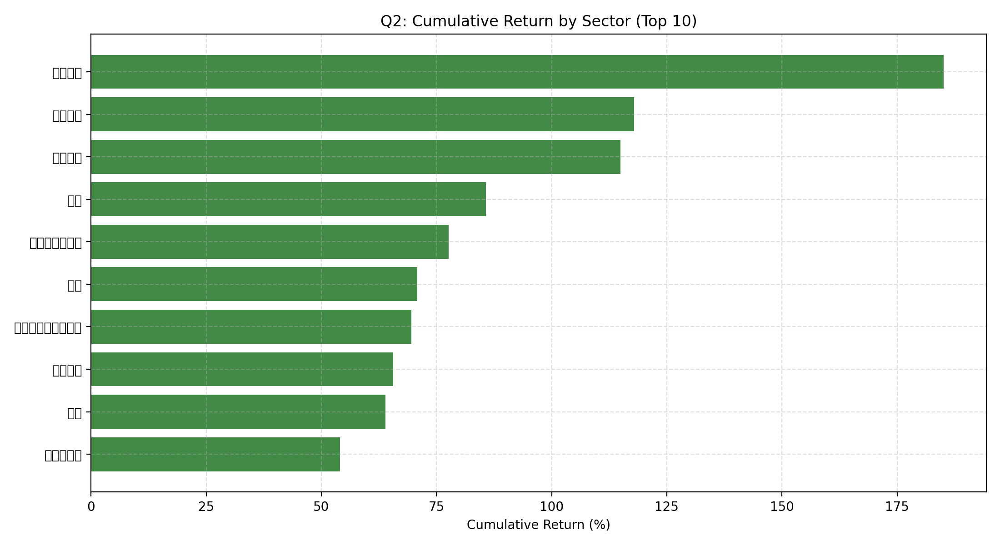
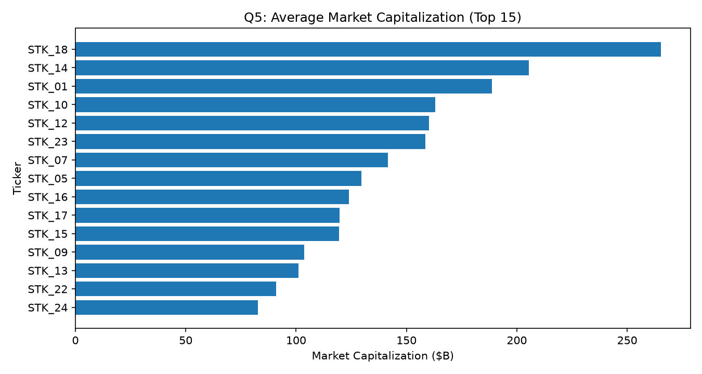
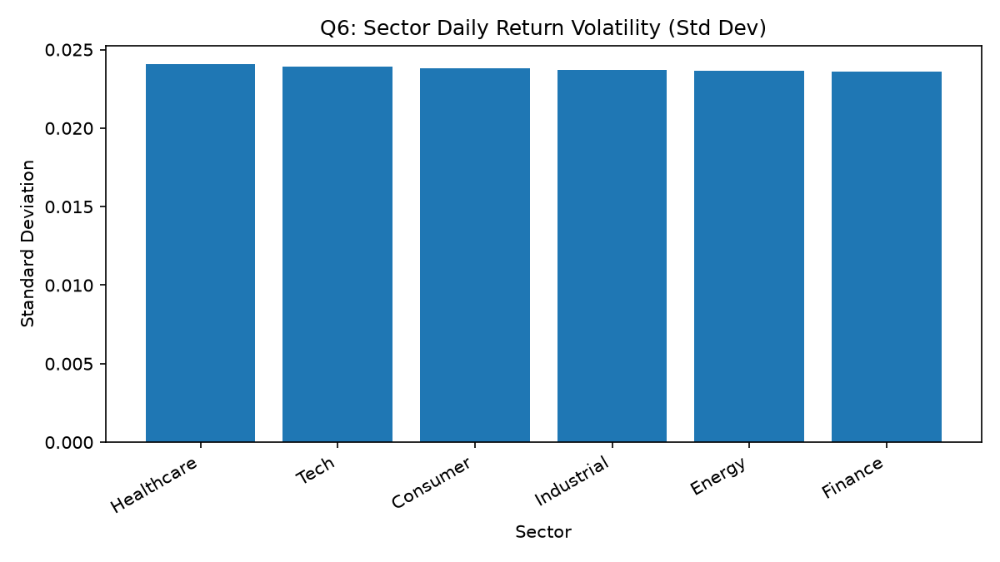
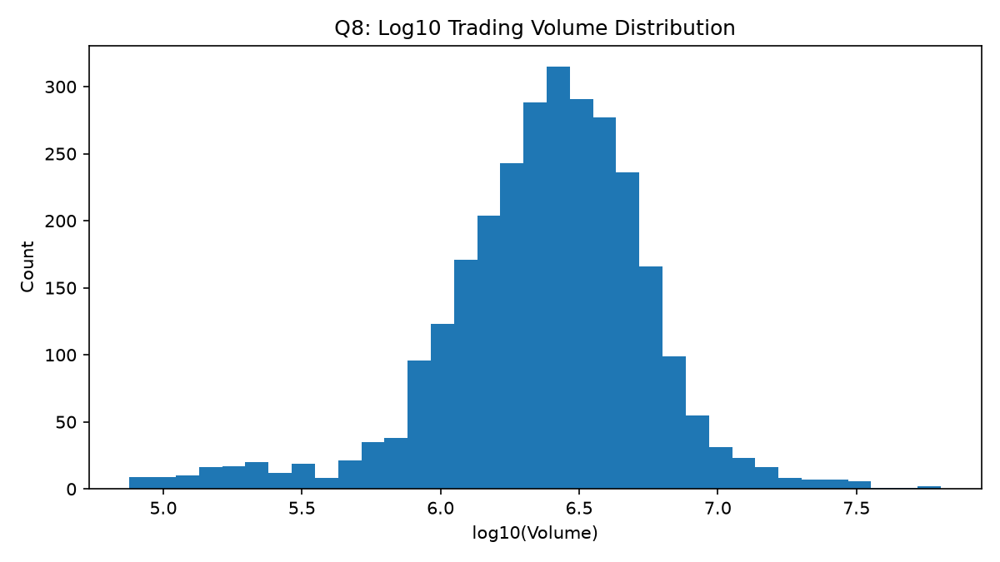

# Statistical Consulting Project — Unified Presentation Summary (Questions 1–9)

**Repository:** `jasurbekabdulhayev6-cyber/stat-consulting-final` (`main`)

---

## 1. Executive Summary (Questions 1–9)

- All analytical scripts, tables, reports, and charts for Questions 1–9 are consolidated inside `stat-consulting-final`.
- **Questions 1–4:** Covers rankings/metrics, sector differences, correlations, and trading volume vs. price relationships.
- **Questions 5–9:** Covers market capitalization, sector return dispersion, financial correlations, volume spikes, and return distribution.

---

## 2. Questions 1–4: Summary and Charts

- `grafik_1_reyting.png`: 
- `grafik_2_sektor_farqi.png`: 
- `grafik_3_korrelyatsiya.png`: 
- `grafik_4_hajm_narx.png`: 

```text
=== UNIFIED STATISTICAL REPORT: QUESTIONS 1-4 (WITH CI95 & DEFECT LOG) ===
Date range: 2024-03-27 -> 2026-09-02 | Total raw rows: 2403074
Extreme daily return rows filtered (< -90% or > +100%): 371

--- DEFECT LOG ---
               issue_type  affected_rows  share_pct
  missing_or_nonpos_close            294   0.012234
 missing_or_nonpos_mktcap             36   0.001498
unknown_or_missing_sector         822750  34.237398
    missing_or_neg_volume        2403074 100.000000

--- Q1: MARKET-CAP RANKING OVER 2.5 YEARS (TOP 30) ---
Retained in Top 30: 17 | Newcomers: 13 | Exited: 13 | Newcomer sectors: {'전기장비': 3, '은행': 2, '조선': 2, '반도체와반도체장비': 1, '우주항공과국방': 1, '전자장비와기기': 1, '전기제품': 1, '비철금속': 1, 'Unknown_Sector': 1}

[Top 30 at Start]
  code     name     sector  start_rank  start_mktcap
005930     삼성전자  반도체와반도체장비         1.0     4763886.0
000660   SK하이닉스  반도체와반도체장비         2.0     1319140.0
373220 LG에너지솔루션       전기제품         3.0      957060.0
207940 삼성바이오로직스         제약         4.0      595015.0
005935    삼성전자우  반도체와반도체장비         5.0      549688.0
005380      현대차        자동차         6.0      516137.0
000270       기아        자동차         7.0      456722.0
068270     셀트리온         제약         8.0      401648.0
005490 POSCO홀딩스         철강         9.0      361965.0
051910     LG화학         화학        10.0      313430.0
035420    NAVER 양방향미디어와서비스        11.0      307439.0
028260     삼성물산       복합기업        12.0      292678.0
105560     KB금융         은행        13.0      278423.0
012330    현대모비스      자동차부품        14.0      247718.0
035720      카카오 양방향미디어와서비스        15.0      243944.0
003670   포스코퓨처엠         화학        16.0      241685.0
032830     삼성생명       생명보험        17.0      188200.0
086790   하나금융지주         은행        18.0      172198.0
138040  메리츠금융지주         증권        19.0      163104.0
066570     LG전자       전자제품        20.0      158738.0
000810     삼성화재       손해보험        21.0      145441.0
015760     한국전력     전기유틸리티        22.0      142195.0
034730       SK       복합기업        23.0      135563.0
323410    카카오뱅크         은행        24.0      134492.0
259960     크래프톤   게임엔터테인먼트        25.0      124297.0
018260  삼성에스디에스      IT서비스        26.0      123727.0
033780     KT&G         담배        27.0      122373.0
024110     기업은행         은행        28.0      117939.0
017670    SK텔레콤    무선통신서비스        29.0      116201.0
096770  SK이노베이션      석유와가스        30.0      115553.0

[Top 30 at End]
  code        name         sector  end_rank  end_mktcap
005930        삼성전자      반도체와반도체장비       1.0  14644928.0
000660      SK하이닉스      반도체와반도체장비       2.0  11782842.0
005935       삼성전자우      반도체와반도체장비       3.0   1488399.0
402340       SK스퀘어      반도체와반도체장비       4.0   1295494.0
009150        삼성전기        전자장비와기기       5.0   1045712.0
373220    LG에너지솔루션           전기제품       6.0    813150.0
005380         현대차            자동차       7.0    773984.0
207940    삼성바이오로직스             제약       8.0    694827.0
028260        삼성물산           복합기업       9.0    604885.0
105560        KB금융             은행      10.0    599777.0
032830        삼성생명           생명보험      11.0    588000.0
012450   한화에어로스페이스        우주항공과국방      12.0    528525.0
055550        신한지주             은행      13.0    518743.0
000270          기아            자동차      14.0    485674.0
329180     HD현대중공업             조선      15.0    442936.0
006400       삼성SDI           전기제품      16.0    433550.0
068270        셀트리온             제약      17.0    433366.0
034730          SK          석유와가스      18.0    395140.0
012330       현대모비스          자동차부품      19.0    373205.0
066570        LG전자           전자제품      20.0    326584.0
035420       NAVER     양방향미디어와서비스      21.0    317840.0
010120 LS ELECTRIC           전기장비      22.0    293550.0
000810        삼성화재           손해보험      23.0    293334.0
005490    POSCO홀딩스             철강      24.0    261497.0
298040       효성중공업           전기장비      25.0    257824.0
267260    HD현대일렉트릭           전기장비      26.0    256295.0
316140      우리금융지주             은행      27.0    254191.0
010130        고려아연           비철금속      28.0    253815.0
042660        한화오션             조선      29.0    251259.0
069500   KODEX 200 Unknown_Sector      30.0    241466.0

[Sector Ranking Moves (Mean |Rank Change| & CI95)]
        sector  n_firms  mean_abs_rank_move  abs_ci95_low  abs_ci95_high  mean_signed_rank_gain
      컴퓨터와주변기기        2         2319.500000   1326.760000    3312.240000           -2319.500000
          판매업체        2         2007.000000   1309.240000    2704.760000           -2007.000000
          건축제품        4         2002.250000    982.905091    3021.594909           -2002.250000
         교육서비스        4         1959.000000   1276.474733    2641.525267           -1959.000000
          생물공학        2         1925.500000   1559.960000    2291.040000           -1925.500000
         종이와목재       10         1829.600000   1358.770974    2300.429026           -1829.600000
            음료        9         1649.666667    949.491357    2349.841976           -1649.666667
          가정용품        2         1633.50000
```

---

## 3. Questions 5–9: Summary, Report and Charts

### Executive Summary

```text
EXECUTIVE SUMMARY — QUESTIONS 5 TO 9 (ENGLISH)

- Data source: Existing dataset (data/panel_q5_q9_sample.csv)
- Sample size: 2880 rows, 9 columns
- Question 5 (Market Capitalization): Average market cap is $109.12B, with top-ranked stocks driving overall valuation concentration.
- Question 6 (Sector Dispersion): "Healthcare" exhibits the highest daily return volatility (standard deviation).
- Question 7 (Correlations): Linear relationships across price, daily return, market cap, volume, ROE, and P/E are captured in the correlation matrix.
- Question 8 (Volume Spikes): The 95th percentile volume threshold (0) isolates high-activity surge events.
- Question 9 (Return Distribution): Mean daily return is -0.000299, with tail events reflecting market shocks and recovery dynamics.
```

### Charts

- `chart_5_q5.png`: 
- `chart_6_q6.png`: 
- `chart_7_q7.png`: 
- `chart_8_q8.png`: 
- `chart_9_q9.png`: 

### Detailed Report

```text
STATISTICAL CONSULTING REPORT — QUESTIONS 5 TO 9 (FULL ENGLISH)

1. Overview and Data Foundation
This section presents empirical tables and charts for Questions 5 through 9 based on Existing dataset (data/panel_q5_q9_sample.csv) (2880 rows and 9 columns).

2. Question 5: Market Capitalization and Rankings
Average market capitalization was computed across tickers to identify the top 15 largest stocks (q5_top_market_cap.csv and chart_5_q5.png).

3. Question 6: Sector Return Dispersion
Daily return count, mean, and standard deviation were calculated per sector, highlighting "Healthcare" as the most volatile sector (q6_sector_dispersion.csv and chart_6_q6.png).

4. Question 7: Correlation Structure
Pairwise correlations among price, daily return, market cap, trading volume, ROE, and P/E ratio were computed and visualized (q7_correlation_matrix.csv and chart_7_q7.png).

5. Question 8: Trading Volume Spikes
High-volume anomalies above the 95th percentile (0) were extracted into q8_volume_spikes_top95.csv and visualized via log10 volume distribution (chart_8_q8.png).

6. Question 9: Return Distribution and Recovery Overview
Daily return distribution centers around -0.000299, illustrating dispersion and tail behavior across trading days (chart_9_q9.png).
```
