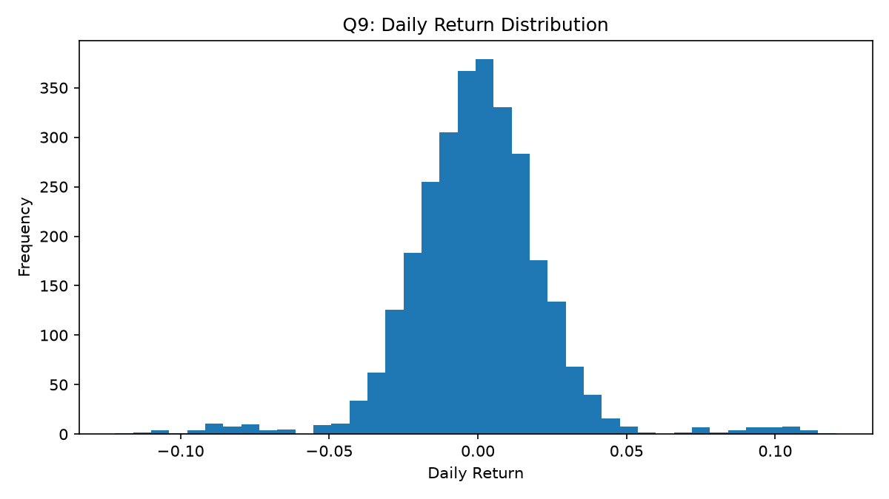

# Statistical Consulting Project - Complete English Presentation (Questions 1-9)

**Repository:** `jasurbekabdulhayev6-cyber/stat-consulting-final` (`main`)

---

## 1. Questions 1-4 Charts

### Question 1 - Market-Cap Rank Movement by Sector


### Question 2 - Cumulative Return by Sector


### Question 3 - Cross-Sector Correlation (Sharp vs. Ordinary Days)


### Question 4 - Trading Volume Spikes and Price Dynamics


---

## 2. Questions 5-9 Charts

### Question 5 - Market Capitalization Rankings


### Question 6 - Sector Return Dispersion


### Question 7 - Cross-Asset / Sector Correlation Matrix


### Question 8 - High-Volume Spike Events (Top 95th Percentile)


### Question 9 - Return Distribution and Tail Behavior


---

## 3. Executive Summary (Questions 5-9)

```text
EXECUTIVE SUMMARY — QUESTIONS 5 TO 9 (ENGLISH)

- Data source: Existing dataset (data/panel_q5_q9_sample.csv)
- Sample size: 2880 rows, 9 columns
- Question 5 (Market Capitalization): Average market cap is $109.12B, with top-ranked stocks driving overall valuation concentration.
- Question 6 (Sector Dispersion): "Healthcare" exhibits the highest daily return volatility (standard deviation).
- Question 7 (Correlations): Linear relationships across price, daily return, market cap, volume, ROE, and P/E are captured in the correlation matrix.
- Question 8 (Volume Spikes): The 95th percentile volume threshold (0) isolates high-activity surge events.
- Question 9 (Return Distribution): Mean daily return is -0.000299, with tail events reflecting market shocks and recovery dynamics.
```

---

## 4. Detailed Report (Questions 1-4)

```text
=== UNIFIED STATISTICAL REPORT: QUESTIONS 1-4 (WITH CI95 & DEFECT LOG) ===
Date range: 2024-03-27 -> 2026-09-02 | Total raw rows: 2403074
Extreme daily return rows filtered (< -90% or > +100%): 371

--- DEFECT LOG ---
               issue_type  affected_rows  share_pct
  missing_or_nonpos_close            294   0.012234
 missing_or_nonpos_mktcap             36   0.001498
unknown_or_missing_sector         822750  34.237398
    missing_or_neg_volume        2403074 100.000000

--- Q1: MARKET-CAP RANKING OVER 2.5 YEARS (TOP 30) ---
Retained in Top 30: 17 | Newcomers: 13 | Exited: 13 | Newcomer sectors: {'Electrical Equipment': 3, 'Banking': 2, 'Shipbuilding': 2, 'Semiconductors와Semiconductors장비': 1, '우주항공과국방': 1, '전자장비와기기': 1, '전기제품': 1, '비철금속': 1, 'Unknown_Sector': 1}

[Top 30 at Start]
  code     name     sector  start_rank  start_mktcap
005930     삼성전자  Semiconductors와Semiconductors장비         1.0     4763886.0
000660   SK하이닉스  Semiconductors와Semiconductors장비         2.0     1319140.0
373220 LGEnergy솔루션       전기제품         3.0      957060.0
207940 삼성Biotechnology로직스         Pharmaceuticals         4.0      595015.0
005935    삼성전자우  Semiconductors와Semiconductors장비         5.0      549688.0
005380      현대차        Automobiles         6.0      516137.0
000270       기아        Automobiles         7.0      456722.0
068270     셀트리온         Pharmaceuticals         8.0      401648.0
005490 POSCO홀딩스         Steel         9.0      361965.0
051910     LGChemicals         Chemicals        10.0      313430.0
035420    NAVER 양방향Media와서비스        11.0      307439.0
028260     삼성물산       복합기업        12.0      292678.0
105560     KB금융         Banking        13.0      278423.0
012330    현대모비스      Automobiles부품        14.0      247718.0
035720      카카오 양방향Media와서비스        15.0      243944.0
003670   포스코퓨처엠         Chemicals        16.0      241685.0
032830     삼성생명       생명Insurance        17.0      188200.0
086790   하나금융지주         Banking        18.0      172198.0
138040  메리츠금융지주         Securities        19.0      163104.0
066570     LG전자       전자제품        20.0      158738.0
000810     삼성화재       손해Insurance        21.0      145441.0
015760     한국전력     전기Utilities        22.0      142195.0
034730       SK       복합기업        23.0      135563.0
323410    카카오뱅크         Banking        24.0      134492.0
259960     크래프톤   게임Entertainment        25.0      124297.0
018260  삼성에스디에스      IT Services        26.0      123727.0
033780     KT&G         담배        27.0      122373.0
024110     기업Banking         Banking        28.0      117939.0
017670    SK텔레콤    무선Telecommunications서비스        29.0      116201.0
096770  SK이노베이션      석유와가스        30.0      115553.0

[Top 30 at End]
  code        name         sector  end_rank  end_mktcap
005930        삼성전자      Semiconductors와Semiconductors장비       1.0  14644928.0
000660      SK하이닉스      Semiconductors와Semiconductors장비       2.0  11782842.0
005935       삼성전자우      Semiconductors와Semiconductors장비       3.0   1488399.0
402340       SK스퀘어      Semiconductors와Semiconductors장비       4.0   1295494.0
009150        삼성전기        전자장비와기기       5.0   1045712.0
373220    LGEnergy솔루션           전기제품       6.0    813150.0
005380         현대차            Automobiles       7.0    773984.0
207940    삼성Biotechnology로직스             Pharmaceuticals       8.0    694827.0
028260        삼성물산           복합기업       9.0    604885.0
105560        KB금융             Banking      10.0    599777.0
032830        삼성생명           생명Insurance      11.0    588000.0
012450   한화에어로스페이스        우주항공과국방      12.0    528525.0
055550        신한지주             Banking      13.0    518743.0
000270          기아            Automobiles      14.0    485674.0
329180     HD현대중공업             Shipbuilding      15.0    442936.0
006400       삼성SDI           전기제품      16.0    433550.0
068270        셀트리온             Pharmaceuticals      17.0    433366.0
034730          SK          석유와가스      18.0    395140.0
012330       현대모비스          Automobiles부품      19.0    373205.0
066570        LG전자           전자제품      20.0    326584.0
035420       NAVER     양방향Media와서비스      21.0    317840.0
010120 LS ELECTRIC           Electrical Equipment      22.0    293550.0
000810        삼성화재           손해Insurance      23.0    293334.0
005490    POSCO홀딩스             Steel      24.0    261497.0
298040       효성중공업           Electrical Equipment      25.0    257824.0
267260    HD현대일렉트릭           Electrical Equipment      26.0    256295.0
316140      우리금융지주             Banking      27.0    254191.0
010130        고려아연           비철금속      28.0    253815.0
042660        한화오션             Shipbuilding      29.0    251259.0
069500   KODEX 200 Unknown_Sector      30.0    241466.0

[Sector Ranking Moves (Mean |Rank Change| & CI95)]
        sector  n_firms  mean_abs_rank_move  abs_ci95_low  abs_ci95_high  mean_signed_rank_gain
      컴퓨터와주변기기        2         2319.500000   1326.760000    3312.240000           -2319.500000
          판매업체        2         2007.000000   1309.240000    2704.760000           -2007.000000
          건축제품        4         2002.250000    982.905091    3021.594909           -2002.250000
         교육서비스        4         1959.000000   1276.474733    2641.525267           -1959.000000
          생물공학        2         1925.500000   1559.960000    2291.040000           -1925.500000
         종이와목재       10         1829.600000   1358.770974    2300.429026           -1829.600000
            음료        9         1649.666667    949.491357    2349.841976           -1649.666667
          가정용품        2         1633.500000   1236.600000    2030.400000           -1633.500000
      레저용장비와제품        2         1601.000000    748.400000    2453.600000           -1601.000000
           부동산        5         1554.600000    670.865016    2438.334984           -1554.600000
          건축자재       31         1548.193548   1179.075929    1917.311167           -1548.193548
           포장재       16         1520.250000   1075.687408    1964.812592           -1520.250000
    식품과기본식료품소매        2         1439.000000    541.320000    2336.680000           -1439.000000
            가구        7         1429.571429    695.369319    2163.773538           -1429.571429
            출판        2         1266.500000    167.920000    2365.080000           -1266.500000
         Automobiles부품       73         1249.164384   1051.595421    1446.733346           -1243.794521
  Textiles,의류,신발,호화품       45         1247.022222    992.870544    1501.173901           -1247.022222
     상업서비스와공급품        9         1224.444444    679.069469    1769.819420           -1224.444444
     방송과Entertainment        8         1149.250000    427.357308    1871.142692           -1149.250000
            Construction       39         1143.820513    800.005582    1487.635443           -1128.538462
            식품       52         1140.461538    874.609064    1406.314013           -1137.230769
    디스플레이장비및부품        3         1122.666667   -247.129052    2492.462385           -1122.666667
          비철금속       26         1114.730769    863.122232    1366.339306           -1113.884615
            Pharmaceuticals       60         1067.650000    831.483567    1303.816433           -1057.716667
          Telecommunications장비        2         1059.000000   -577.600000    2695.600000           -1059.000000
            Steel       36         1043.861111    805.760859    1281.961363           -1043.861111
     항공화물Transportation과물류       10         1020.400000    554.633704    1486.166296           -1020.400000
            Machinery       20          945.000000    637.752524    1252.247476            -936.100000
       무선Telecommunications서비스        3          887.333333   -830.283355    2604.950022            -887.333333
Unknown_Sector       21          876.666667    579.815059    1173.518274            -876.666667
           해운사        8          868.250000    256.853999    1479.646001            -868.250000
          전자제품        4          861.250000   -110.034447    1832.534447            -861.250000
       디스플레이패널        2          853.000000   -711.080000    2417.080000            -853.000000
     건강관리장비와용품        5          850.600000    268.041112    1433.158888            -850.600000
       전자장비와기기       20          832.100000    421.729762    1242.470238            -799.400000
          손해Insurance       10          819.900000    -50.210278    1690.010278            -819.900000
            Chemicals       72          799.638889    644.124726     955.153052            -775.916667
         IT Services       13          740.615385    372.600648    1108.630121            -737.846154
          전기제품       11          733.000000    141.815191    1324.184809            -715.363636
      백화점과일반상점       12          710.166667    226.696238    1193.637096            -628.166667
            Securities       33          697.575758    369.334015    1025.817500            -675.272727
    호텔,레스토랑,레저        6          688.166667    198.749940    1177.583394            -676.833333
       도로와철도Transportation        5          668.000000    299.197992    1036.802008            -516.400000
           항공사        8          648.125000    109.413167    1186.836833            -606.375000
         석유와가스       12          573.916667    240.483238     907.350096            -571.250000
        가스Utilities       11          560.545455    322.025839     799.065070            -560.545455
          Electrical Equipment       13          558.000000    107.355221    1008.644779            -404.923077
           화장품       18          532.833333    329.093732     736.572934            -518.388889
           Automobiles        9          504.222222      3.210458    1005.233987            -504.222222
            광고        3          488.000000   -147.313172    1123.313172            -488.000000
     무역회사와판매업체        7          438.857143    115.325533     762.388752            -346.285714
      가정용기기와용품        5          438.200000   -152.481178    1028.881178            -438.200000
     Semiconductors와Semiconductors장비       16          428.437500     70.888740     785.986260            -402.312500
       우주항공과국방        7          426.857143    -33.708388     887.422673            -175.714286
           핸드셋        3          417.333333    246.643201     588.023466            -417.333333
          복합기업       16          400.875000     60.146561     741.603439            -350.625000
     Energy장비및서비스        9          331.444444    -61.669283     724.558172            -293.666667
        전기Utilities        4          289.250000     95.273735     483.226265            -289.250000
      게임Entertainment        4          230.750000    -80.150913     541.650913            -230.750000
            Shipbuilding       11          187.363636    -71.456541     446.183814            -135.363636
          생명Insurance        3          186.000000   -124.679064     496.679064            -148.666667
    양방향Media와서비스        3          175.666667   -124.873058     476.206391            -175.666667
            Banking       10           76.000000     -5.717872     157.717872             -52.200000

--- Q2: SECTOR RETURN GAP & DISPERSION ---
Early-half daily std (CI95): 0.010402 [0.009878, 0.010925]
Late-half daily std (CI95):  0.012798 [0.012185, 0.013410]
Change (Late - Early):       +0.002396

[Cumulative Return by Sector (%)]
        sector  cum_return_pct
          Electrical Equipment      185.129236
          생명Insurance      117.909461
          복합기업      114.938329
            Securities       85.707862
       도로와철도Transportation       77.652098
            Banking       70.819227
     다각화된Telecommunications서비스       69.585885
          손해Insurance       65.592179
            Shipbuilding       63.957288
         Transportation인프라       54.011552
      백화점과일반상점       37.807572
Unknown_Sector       31.743433
          Telecommunications장비       30.338709
            Construction       30.269537
        전기Utilities       29.192410
     Semiconductors와Semiconductors장비       27.707658
         석유와가스       17.784764
        가스Utilities       16.375514
            Machinery       15.509276
       디스플레이패널       14.586858
           해운사       10.136833
           화장품        9.047397
     Energy장비및서비스        7.952062
          창업투자        6.654618
       우주항공과국방        6.332378
     무역회사와판매업체        6.140449
      컴퓨터와주변기기        4.706841
    인터넷과카탈로그소매        3.513652
          Other금융        1.793282
          건축자재        1.628635
          생물공학        0.164809
       전자장비와기기       -0.629060
            식품       -1.160013
      레저용장비와제품       -2.891877
            Steel       -3.725978
            Chemicals       -7.200092
         Automobiles부품       -7.505815
           Automobiles       -8.043892
          건축제품      -10.001287
     항공화물Transportation과물류      -10.102427
          비철금속      -11.841273
     상업서비스와공급품      -11.896121
           포장재      -12.759329
        건강관리기술      -12.964877
    식품과기본식료품소매      -14.037635
         IT Services      -15.856374
    건강관리업체및서비스      -17.238609
           부동산      -17.643190
            가구      -18.343432
         교육서비스      -19.000042
           항공사      -19.827509
       무선Telecommunications서비스      -20.273980
    디스플레이장비및부품      -21.878726
  Textiles,의류,신발,호화품      -22.388650
    생명과학도구및서비스      -23.125347
            Pharmaceuticals      -23.891762
     건강관리장비와용품      -25.064449
          가정용품      -27.472644
          전기제품      -27.478639
    호텔,레스토랑,레저      -27.722412
            음료      -28.158676
      게임Entertainment      -28.462496
          전자제품      -29.758450
          판매업체      -29.916170
    양방향Media와서비스      -32.009406
         Software      -35.394833
            출판      -36.392307
         종이와목재      -36.880661
           핸드셋      -37.137629
          전문소매      -37.474271
      가정용기기와용품      -40.382772
            광고      -47.206630
     방송과Entertainment      -51.054394

[Key Sectors Driving Dispersion (Leave-One-Out)]
        sector  var_drop_when_excluded  share_of_dispersion_pct
          Electrical Equipment            9.866847e-06                 2.905534
     Semiconductors와Semiconductors장비            7.003236e-06                 2.062274
        전기Utilities            6.949540e-06                 2.046462
       우주항공과국방            5.966023e-06                 1.756841
     Energy장비및서비스            4.883906e-06                 1.438185
            Shipbuilding            4.404605e-06                 1.297044
          생명Insurance            3.211988e-06                 0.945848
        건강관리기술            3.209054e-06                 0.944984
          Telecommunications장비            3.041339e-06                 0.895597
          전기제품            2.798367e-06                 0.824048
            Securities            2.070566e-06                 0.609729
     다각화된Telecommunications서비스            1.586961e-06                 0.467319
            출판            1.460143e-06                 0.429975
          복합기업            1.143467e-06                 0.336722
          생물공학            1.114927e-06                 0.328318
    건강관리업체및서비스            1.076130e-06                 0.316893
            Machinery            9.508718e-07                 0.280007
    양방향Media와서비스            8.508662e-07                 0.250558
           Automobiles            7.961959e-07                 0.234459
       도로와철도Transportation            6.452356e-07                 0.190005
     무역회사와판매업체            5.479076e-07                 0.161345
       전자장비와기기            5.263883e-07                 0.155008
           부동산            3.182800e-07                 0.093725
    인터넷과카탈로그소매            1.848800e-07                 0.054442
    생명과학도구및서비스            1.386756e-07                 0.040836
          손해Insurance            6.202239e-08                 0.018264
           항공사            2.818522e-08                 0.008300
           핸드셋           -7.964491e-09                -0.002345
           해운사           -9.810002e-08                -0.028888
         IT Services           -1.722782e-07                -0.050732
           화장품           -1.739574e-07                -0.051226
       무선Telecommunications서비스           -1.787172e-07                -0.052628
    디스플레이장비및부품           -1.856881e-07                -0.054680
         Software           -2.764150e-07                -0.081397
          Other금융           -2.854276e-07                -0.084051
            Banking           -5.478847e-07                -0.161338
          판매업체           -6.214228e-07                -0.182993
    식품과기본식료품소매           -6.967118e-07                -0.205164
            Construction           -7.027350e-07                -0.206937
      백화점과일반상점           -7.967302e-07                -0.234617
          전문소매           -8.316841e-07                -0.244910
            가구           -8.345561e-07                -0.245755
     건강관리장비와용품           -9.208724e-07                -0.271173
      가정용기기와용품           -9.322470e-07                -0.274523
            광고           -9.679610e-07                -0.285040
      게임Entertainment           -1.015868e-06                -0.299147
            Pharmaceuticals           -1.063252e-06                -0.313100
          가정용품           -1.159927e-06                -0.341569
      레저용장비와제품           -1.163144e-06                -0.342516
     방송과Entertainment           -1.234905e-06                -0.363648
         석유와가스           -1.379162e-06                -0.406128
         Transportation인프라           -1.387012e-06                -0.408440
    호텔,레스토랑,레저           -1.423492e-06                -0.419182
       디스플레이패널           -1.468146e-06                -0.432332
          건축자재           -1.544370e-06                -0.454777
         Automobiles부품           -1.561294e-06                -0.459761
          전자제품           -1.648300e-06                -0.485382
          비철금속           -1.653346e-06                -0.486868
            Chemicals           -1.720169e-06                -0.506546
          건축제품           -1.744968e-06                -0.513849
     항공화물Transportation과물류           -1.801987e-06                -0.530639
      컴퓨터와주변기기           -1.818795e-06                -0.535589
            Steel           -1.850140e-06                -0.544819
         교육서비스           -2.148577e-06                -0.632701
        가스Utilities           -2.255901e-06                -0.664305
         종이와목재           -2.365207e-06                -0.696493
  Textiles,의류,신발,호화품           -2.438494e-06                -0.718074
           포장재           -2.663405e-06                -0.784305
            식품           -2.701566e-06                -0.795542
     상업서비스와공급품           -3.167222e-06                -0.932666
            음료           -3.207146e-06                -0.944423
Unknown_Sector           -3.792573e-06                -1.116816
          창업투자           -4.239847e-06                -1.248527

--- Q3: CROSS-SECTOR CORRELATION (SHARP MOVES VS ORDINARY DAYS) ---
Overall pairwise corr (CI95):  0.5669 [0.5615, 0.5723]
Sharp market move days (CI95): 0.8275 [0.8236, 0.8314] (n_pairs=2628)
Ordinary days corr (CI95):     0.3266 [0.3213, 0.3319] (n_pairs=2628)

[Top 30 Correlated Sector Pairs]
  sector_a   sector_b  correlation
     IT Services      Software     0.931497
      전기제품    전자장비와기기     0.925800
      생물공학         Pharmaceuticals     0.925006
 건강관리장비와용품         Pharmaceuticals     0.924413
디스플레이장비및부품    전자장비와기기     0.923982
   전자장비와기기        핸드셋     0.922778
      전기제품         Chemicals     0.918868
 Semiconductors와Semiconductors장비    전자장비와기기     0.909732
   전자장비와기기         Chemicals     0.907765
디스플레이장비및부품        핸드셋     0.905170
생명과학도구및서비스         Pharmaceuticals     0.900738
 건강관리장비와용품       생물공학     0.891092
 건강관리장비와용품 생명과학도구및서비스     0.889144
디스플레이장비및부품  Semiconductors와Semiconductors장비     0.885914
     Automobiles부품         Chemicals     0.884880
     Automobiles부품    전자장비와기기     0.881471
        Machinery      Automobiles부품     0.878849
        Machinery    전자장비와기기     0.878589
디스플레이장비및부품         Chemicals     0.878372
       핸드셋         Chemicals     0.874604
생명과학도구및서비스       생물공학     0.874472
      전기제품        핸드셋     0.874108
     Automobiles부품        핸드셋     0.871996
        Machinery        핸드셋     0.871571
디스플레이장비및부품      Automobiles부품     0.869893
디스플레이장비및부품       전기제품     0.865729
     IT Services    전자장비와기기     0.856466
 Semiconductors와Semiconductors장비        핸드셋     0.856272
     IT Services      Automobiles부품     0.854917
     IT Services        핸드셋     0.854840

--- Q4: VOLUME SPIKE — LEAD VS FOLLOW (+5, +10, +20 DAYS & SENSITIVITY) ---
```

---

## 5. Detailed Report (Questions 5-9)

```text
STATISTICAL CONSULTING REPORT — QUESTIONS 5 TO 9 (FULL ENGLISH)

1. Overview and Data Foundation
This section presents empirical tables and charts for Questions 5 through 9 based on Existing dataset (data/panel_q5_q9_sample.csv) (2880 rows and 9 columns).

2. Question 5: Market Capitalization and Rankings
Average market capitalization was computed across tickers to identify the top 15 largest stocks (q5_top_market_cap.csv and chart_5_q5.png).

3. Question 6: Sector Return Dispersion
Daily return count, mean, and standard deviation were calculated per sector, highlighting "Healthcare" as the most volatile sector (q6_sector_dispersion.csv and chart_6_q6.png).

4. Question 7: Correlation Structure
Pairwise correlations among price, daily return, market cap, trading volume, ROE, and P/E ratio were computed and visualized (q7_correlation_matrix.csv and chart_7_q7.png).

5. Question 8: Trading Volume Spikes
High-volume anomalies above the 95th percentile (0) were extracted into q8_volume_spikes_top95.csv and visualized via log10 volume distribution (chart_8_q8.png).

6. Question 9: Return Distribution and Recovery Overview
Daily return distribution centers around -0.000299, illustrating dispersion and tail behavior across trading days (chart_9_q9.png).
```
